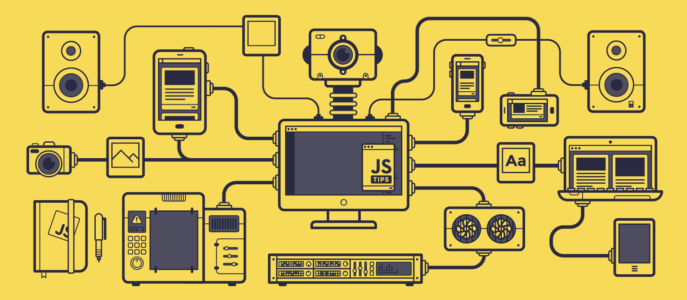

# Hi there, I'm Mohd Attesham Shaikh 👋

  
  
  

A passionate, results-driven **Software Developer** with deep expertise in building high-performance fintech platforms, automated payment gateways, and scalable enterprise web applications. Dedicated to crafting pixel-perfect, responsive user interfaces, streamlining approval workflows, and optimizing complex digital user journeys.

---

### 👨‍💻 About Me

- 💼 **Currently:** Software Developer at **Q2Pay Technologies Pvt. Ltd.**, building nationwide vendor payment platforms, multi-account settlement flows, and custom approval matrix architectures.
- 🏢 **Previous Experience:** Engineered enterprise growth portals, partner engagement platforms, and lead qualification systems.
- 🎓 **Education:** Master of Computer Applications (MCA).
- 🚀 **Core Specialty:** Modern frontend architecture using **React.js**, **Redux**, dynamic component systems, and seamless backend API integrations.
  
---

### 🛠️ Tech Stack & Toolkit

| Category | Technologies & Tools |
| :--- | :--- |
| **Frontend Core** |     |
| **UI Frameworks & Styling** |    |
| **State & Architecture** |  • Dynamic Component Design • Responsive Layouts • ERP Integration |
| **Backend & Databases** |    |
| **Tools & Platforms** |    |

---

### 🌟 Key Highlights & Production Experience

- **Fintech & Payment Automation:** Engineered authorization matrices enabling tiered corporate transaction approvals and real-time ERP settlement flows.
- **Enterprise Scale:** Scaled multi-account vendor payment infrastructure handling cross-country transfers with high security standards.
- **Pixel-Perfect Responsive Engineering:** Designed high-conversion UI layouts with dynamic component reusability and cross-device compatibility.
- **Full Product Lifecycle:** Led features from wireframing, component design, and state architecture to backend API integrations and production rollout.

---

### ⚡ Beyond the Code

- 🏋️‍♂️ Fitness & gym enthusiast, keeping discipline high both in life and code.
- ⚽ Passionate about outdoor sports, travel, and music.
- 💡 Always exploring clean code architectures, UI optimization patterns, and modern web paradigms.

---

### 🌐 Connect With Me

  
  
  

